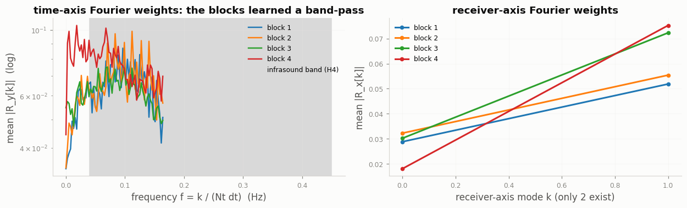
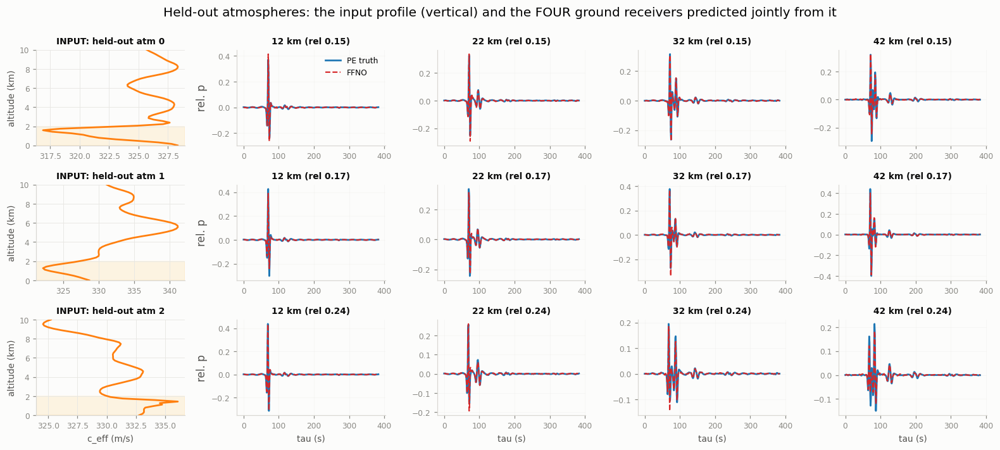
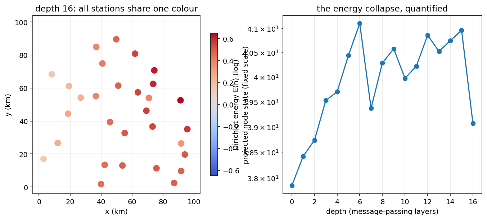

# LETMA 2026 — Machine Learning on Geophysical Data: three hands-on labs

**Fourier Neural Operators (FNO) · Factorized FNO for infrasound (FFNO) · Graph Neural Networks (GNN) · a Darcy-flow scale-up**

Three self-contained, 30-minute lab notebooks for a summer-school audience that mixes
**complete newcomers to machine learning** and **rigorous mathematicians**: every assumption is
stated as a numbered hypothesis (H1, H2, …) before it is used, every exercise is fail-safe
(automatic checker + reference fallback), and every lab is driven by animations — from PDE
dynamics and **favourable/unfavourable infrasound ducting** (wavefields, rays, hodographs) to
**animated loss landscapes with multiple minima, optimizer races to the final loss, and the
Dirichlet-energy collapse of deep GNNs**.

| Lab | Question | Method | Data | Exercise |
|---|---|---|---|---|
| **1 · [FNO for Burgers](notebooks/labs/lab_fno_student.ipynb)** | Can a network learn a PDE's solution operator? | Fourier Neural Operator (Li et al., ICLR 2021) | 1-D viscous Burgers, generated on the fly | implement `SpectralConv1d` |
| **2 · [FFNO for infrasound](notebooks/labs/lab_ffno_infrasound_student.ipynb)** | Can a network predict ground waveforms from the boundary-layer profile that shaped them? | Factorized FNO (Tran et al., ICLR 2023) | narrow-angle parabolic-equation solver, synthetic atmospheres | implement the trace spectrum |
| **3 · [GNN for a sensor network](notebooks/labs/lab_gnn_student.ipynb)** | How do we learn on stations scattered on a map — any number of them, some always down? | Graph Neural Network (PyTorch Geometric) | synthetic seismic network with station dropout | implement the message-passing layer |
| **Extension · [Darcy scale-up](notebooks/extensions/scaleup_darcy_fno2d.ipynb)** | The same method, long-schedule regime | **small FFNO2d** (123k params) × **200 epochs** | **2304 pre-generated 96×96 Darcy pairs** (shipped in `data/`) | — |

Each lab exists in two versions: `*_student.ipynb` (exercises with `TODO`s) and
`*_solution.ipynb` (executed end-to-end, all figures and animations embedded — open it to see
everything without running a single cell).

---

## What you will actually see (illustrations)

**Lab 1 — the operator being learned, and its loss landscape with several minima.**
Left: the statistical distributions of the inputs and outputs (per-sample norms vary ×6 — the
imbalance the loss must handle). Right: the same problem trained twice from different seeds
gives two different minima; three Adam initializations each fall into their own basin.

| | |
|---|---|
|  |  |

The single-minimum view of the same landscape, with four optimizers racing **to the final trained
loss**: Adam arrives in 83 steps, momentum in 463, plain fixed-step SGD never leaves the plateau.
A hyperparameter **corner plot** (modes, width, depth, projection width) and a **3-D view**
complete the section. The payoff of Fourier layers: parameters live on **modes, not grid
points**, so the model trained at $N=64$ evaluates zero-shot at $N=256$ with the same error.

| | |
|---|---|
|  |  |

**Lab 2 — favourable vs unfavourable atmospheres, from three complementary viewpoints.**
A **favourable** boundary layer (surface faster than the air above) traps infrasound; an
**unfavourable** one lets it escape. Top: the input profiles (vertical: altitude on $y$, celerity
on $x$) and the ray fans they produce — 23 ground returns vs 0. Bottom: the same story in the
**hodograph** (rescaled traces stacked by receiver range, with the ray-predicted arrival times)
and in the value distributions of inputs and outputs.

| | |
|---|---|
|  |  |
|  |  |

The FFNO predicts **all four ground receivers jointly, in one evaluation**. Inside the network:
the encoder compresses each atmosphere into a 16-number code (correlating −0.56 with physical
favourability), and the spectral blocks' **learned Fourier weights** concentrate on the
infrasound band — a learned band-pass, with the input profile shown beside every prediction.

| | |
|---|---|
|  |  |

**Lab 3 — a graph built by k-NN, and its specific failure mode, quantified.**
Left: the input distributions (per-event station counts change the graph size every event — H3).
Right: oversmoothing made quantitative — node colours homogenize *while the Dirichlet energy
collapses*, with the energy curve animating alongside the map.

| | |
|---|---|
|  |  |

The notebook itself animates, step by step, **how k-nearest-neighbours constructs the graph node
by node** (candidates in grey, the 6 selected edges in red, committed edges in blue).

**Extension — a small factorized network, trained long, on a big database.** The FFNO2d of
Lab 2 — deliberately **small** (width 20, modes 14², 5 blocks, 123k parameters, ×6 fewer
spectral parameters per layer than a full 2-D FNO) — trained for **200 epochs** on **2304
pre-generated 96×96 Darcy pairs** (finite-volume ground truth, shipped as a half-precision
85 MB file): the long-schedule regime. Input/output distributions, the spectral check (H5), a
prediction-improving animation, the **learned Fourier weights dissected layer by layer**
(the x/y responses match at ratio 1.03, exactly as the isotropy of the law predicts), and a
worst-case gallery. The executed solution trained the full budget **in 3 minutes on an H100
(~10 minutes on the school's MIG 1g.20gb slice)** and reaches test rel-$L^2$ **0.0083** —
*better* than the ~0.01 the operator-learning literature reports for this benchmark, from a
model smaller than the Burgers lab network. On a laptop CPU set `DARCY_EPOCHS=10`–`20`, or read
the executed solution.

| | | |
|---|---|---|
|  |  |  |

More animations (message passing hop by hop, training converging epoch by epoch, code-space
interpolation) live **inside the executed solution notebooks**; a few legacy GIFs are in
[`docs/images/animations/`](docs/images/animations).

---

## Pedagogical design (why a mixed audience can follow all of it)

- **🧭 novice track / 📐 rigor track.** Grey 🧭 boxes define every ML term before it is used;
  📐 boxes state each assumption as a numbered hypothesis — the Burgers GRF law (H1), the
  paraxial solver's approximations (H1–H8), the GNN velocity model and pick noise (H1–H7), the
  encoder's information bottleneck (H14), the Darcy data law (H1–H5)… Nothing is used before it
  is defined, and every hypothesis that can be checked on data *is* checked (spectral decay,
  band content, ray vs PE arrivals).
- **A checked 30-minute critical path.** ⏱ checkpoints at each section header tell students
  where they should be; exercises have hard-stop instructions and **cannot block anyone**:
  an automatic checker compares against a reference, and on failure the reference takes over.
- **🥾 Optional deep dives** (3-D landscapes, corner plots, Fourier-weight dissection, the
  classic ML pathologies — non-convexity measured across 5 seeds, data imbalance, overfitting
  under 8 samples, distribution shift with an out-of-ensemble profile) are executed in the
  solutions and skippable live.
- **Honesty as a teaching tool.** Every number the labs report is one the notebooks actually
  produced; the notebooks say which conclusions are robust and which are visualization-level.

---

## Quick start

```bash
git clone <this-repo>
cd letma2026-ml-labs
python -m venv .venv && source .venv/bin/activate
pip install -r requirements.txt          # CPU is enough; GPU optional
jupyter lab                               # or: jupyter notebook
```

Open `notebooks/labs/lab_fno_student.ipynb` and run top to bottom. The three labs generate all
their data on the fly (Burgers pseudo-spectral solver, infrasound parabolic-equation marcher,
synthetic seismic picks) — no downloads. The Darcy scale-up loads its 2304-pair 96×96 database from the shipped
`data/darcy96_big.pt` (half precision, 85 MB; regenerating it requires `scipy` and ~2 minutes).

On the Hedy cluster everything is pre-staged in the account's shared folder
(`/home/projects/m26266/letma2026-ml-labs`, repo + venvs). Re-validating the whole set is a
**single command after a single SSH hop** — `sbatch slurm/test_all_mig.sbatch` from that folder
(see `slurm/PROCEDURE_TESTS.md`) — with the mandatory MIG directives
(`--nodelist=m-gpu[07-08]`, `--reservation=test_mig_letma`,
`--gres=gpu:nvidia_h100_80gb_hbm3_1g.20gb:1`, `--account=m26266`) already in the script.

## For participants: using this environment on Hedy

Hedy homes are **private** (and scratch/save are per-user), so participants do **not** — and
should not — run the instructor's `~/envs`. The supported route is **self-service**, and it has
been executed end-to-end on the cluster:

```bash
# once, on the login node (~6 min, mostly the torch wheel download):
git clone <this-repository> && cd letma2026-ml-labs
bash scripts/setup_participant.sh          # builds YOUR OWN ~/envs/fno-gnn from the
                                           # pinned requirements, registers the Jupyter
                                           # kernel 'fno-gnn', smoke-tests the imports
source ~/envs/fno-gnn/bin/activate
# then request your GPU (the school's MIG allocation) and launch jupyter from the job
```

The script picks Hedy's module Python (3.12.4) automatically, verifies ≥ 3.10, installs from
`requirements.txt`, and prints a smoke test (`torch`, `torch_geometric`, `matplotlib`) — CUDA
correctly reads `False` on the login node and `True` inside a GPU job. **Validated on the
cluster**: a fresh participant venv (torch 2.15+cu132, PyG 2.8.1) imports cleanly; participants
may resolve slightly newer wheels than the instructor's validated env — every API used in the
labs is stable across these versions.

**Or use the shared environment directly (zero setup).** Everything is pre-staged in the
account's shared folder on Hedy, `/home/projects/m26266/letma2026-ml-labs` (repo +
ready-made venvs, group-readable):

```bash
source /home/projects/m26266/letma2026-ml-labs/scripts/use_instructor_env.sh
cp /home/projects/m26266/letma2026-ml-labs/notebooks/labs/lab_fno_student.ipynb ~/my_lab.ipynb
euporie-notebook --kernel-name python3 ~/my_lab.ipynb
```

The `python3` kernel IS the validated interpreter (the shared venv's own — no registration
needed for the three labs; one registration line for the JAX extensions, in the script
header). The shared environment is read-only for participants: no pip installs. It was
re-validated end-to-end from the shared location on the cluster (labs + Darcy scale-up + JAX
executed on a GPU with the shared venvs, and Euporie rendering a lab in its TUI).

Two *alternative* mechanisms, if the school prefers them (not required):

- **Apptainer/Singularity** (installed system-wide on Hedy): build one `.sif` with
  `torch + torch_geometric + jupyter` and share it through a *group-readable* location.
  Blocked today by the missing piece below.
- **A shared read-only venv at a common path**: venvs work for any user if the path is common
  and permissions allow; the natural place would be an account-shared directory
  (`/save-rhet/…`) for the school's Slurm account — **worth requesting from the mesocentre
  admins**, who could also host the Apptainer image and the pip cache to spare 48
  simultaneous downloads. Opening the instructor's `$HOME` with `chmod a+rX` also works
  technically but is poor cluster etiquette and not recommended.

## Requirements and measured hardware footprint

**Software**: Python ≥ 3.10 (tested on 3.12/3.13); see [`requirements.txt`](requirements.txt).
The three labs need only PyTorch + PyTorch Geometric + NumPy/Matplotlib/Jupyter. Optional:
`scipy` (to regenerate the Darcy database), `jax[cuda12]`/`equinox`/`optax` (the JAX
extensions, separate venv advised).

**Hardware** (measured on the executed solutions):

| Resource | CPU-only (laptop) | GPU (tested on a MIG slice of an H100) |
|---|---|---|
| Processor | any ≥ 2 cores (4+ comfortable) | any CUDA 12 GPU |
| GPU memory | — | **≥ 4 GB** — everything runs on a 19.6 GB `MIG 1g.20gb` instance |
| System RAM | **~1 GB free** (labs), **~3 GB** (scale-up: 1200×2×64² float32) | ~1–3 GB |
| Disk | ~150 MB repo (incl. the 85 MB shipped Darcy database) | same |
| Lab 1 / 2 / 3 runtime | ≈ 8 / 6 / 2 min (≈ 2–3 min on the 30-min critical path) | **78 s / 39 s / 47 s** |
| Darcy scale-up (200 epochs) | hours — set `DARCY_EPOCHS=10`–`20` or read the solution | **3.0 min** (full H100) / ~10 min (`MIG 1g.20gb`) |
| JAX extensions | n/a | 26 s + 9 s |

Nothing requires internet access at run time. Results are deterministic (fixed seeds); GPU and
CPU runs agree to ~3 decimals (e.g. Darcy test rel-L2 0.0405 CPU vs 0.0404 GPU).

## Repository layout

```text
letma2026-ml-labs/
├── README.md                     ← this file
├── scripts/
│   └── setup_participant.sh      ← one-time participant setup (Hedy or laptop)
├── INSTRUCTOR_GUIDE.md           ← pacing, checkpoints, fallbacks, cluster notes
├── requirements.txt               ← install file (+ optional extras commented)
├── data/
│   └── darcy96_big.pt            ← pre-generated 96×96 Darcy database (2304 pairs, 85 MB, fp16)
├── fno_tuto/                      ← Burgers/Darcy data generators, losses, FNO/FFNO models
│   └── infrasound.py              ← parabolic-equation solver + synthetic atmospheres
├── gnn_tuto/                      ← seismic simulator, graph construction, GNN models, checkers
├── hedy_euporie/                  ← tiny optional session-profiler used by the labs
├── notebooks/
│   ├── labs/                      ← the three 30-minute labs (student + executed solution)
│   └── extensions/                ← Darcy scale-up + JAX reimplementations
├── docs/images/                   ← README illustrations (extracted from the executed solutions)
└── slurm/                         ← single-hop validation scripts (see PROCEDURE_TESTS.md)
```

## Reproducibility status

All notebooks were executed end-to-end **without a single error**, twice — once on CPU (laptop)
and once on a GPU cluster (MIG 1g.20gb instance of an H100, Slurm reservation). Key reproduced
numbers: Burgers test rel-$L^2$ 0.076 (zero-shot at $N{=}256$: 0.073); two-seed Burgers minima
0.083/0.084 with three Adam initializations in separate basins; infrasound test 0.16, code–
favourability correlation −0.56, ray tracing 23 vs 0 ground returns, Fourier-weight peak at
0.096 Hz (inside the 0.04–0.45 Hz band); GNN epicentral median 4.87 km vs MLP baseline 6.92 km;
Darcy scale-up: a 123k-parameter FFNO2d, 200 epochs on 2304 pairs at 96×96, test rel-$L^2$
0.0083 in 3 GPU minutes on a full H100 (measured; ~10 min on the MIG slice); learned x/y Fourier
responses equal to 3%, as the isotropic law predicts.

## License

MIT — see [`LICENSE`](LICENSE). If you use these labs for teaching, an acknowledgement of the
LETMA 2026 summer school is appreciated.
