# LETMA 2026 — Machine Learning on Geophysical Data: three hands-on labs

**Fourier Neural Operators (FNO) · Factorized FNO for infrasound (FFNO) · Graph Neural Networks (GNN) · a Darcy-flow scale-up**

Three self-contained, 30-minute lab notebooks for a summer-school audience that mixes
**complete newcomers to machine learning** and **rigorous mathematicians**: every assumption is
stated as a numbered hypothesis (H1, H2, …) before it is used, every exercise is fail-safe
(automatic checker + reference fallback), and every lab is driven by animations — from PDE
dynamics and **boundary-layer infrasound propagation** (wavefields, rays, hodographs) to
**animated loss landscapes with multiple minima, optimizer races to the final loss, and the
Dirichlet-energy collapse of deep GNNs**.

| Lab | Question | Method | Data | Exercise |
|---|---|---|---|---|
| **1 · [FNO for Burgers](notebooks/labs/lab_fno_student.ipynb)** | Can a network learn a PDE's solution operator? | Fourier Neural Operator (Li et al., ICLR 2021) | 1-D viscous Burgers, generated on the fly | implement `SpectralConv1d` |
| **2 · [FFNO for infrasound](notebooks/labs/lab_ffno_infrasound_student.ipynb)** | Can a network predict ground waveforms from the boundary-layer profile that shaped them? | Factorized FNO (Tran et al., ICLR 2023) | narrow-angle parabolic-equation solver, synthetic atmospheres | implement the trace spectrum |
| **3 · [GNN for a sensor network](notebooks/labs/lab_gnn_student.ipynb)** | How do we learn on stations scattered on a map — any number of them, some always down? | Graph Neural Network (PyTorch Geometric) | synthetic seismic network with station dropout | implement the message-passing layer |
| **Extension · [Darcy scale-up](notebooks/extensions/scaleup_darcy_fno2d.ipynb)** | The same method, long-schedule regime | **small FFNO2d** (123k params) × **200 epochs** | **2304 pre-generated 96×96 Darcy pairs** (shipped in `data/`) | — |
| **Extension · [Lab 1 in JAX](notebooks/extensions/jax_fno_student.ipynb)** | The same FNO lab, in the other framework | JAX + Equinox + Optax (vmap, jit, pytree landscapes) | Lab 1's Burgers samples (shipped as `data/burgers_jax.npz`) | `SpectralConv1d` + the forward pass |
| **Extension · [Lab 3 in JAX](notebooks/extensions/jax_gnn_student.ipynb)** | The same GNN lab, without PyTorch Geometric | JAX + Equinox + Optax (padded + masked batching) | the same seismic events (shipped as `data/seismic_jax.npz`) | masked mean-aggregation + the full locator |

Each lab exists in two versions: `*_student.ipynb` (exercises with `TODO`s) and
`*_solution.ipynb` (executed end-to-end, all figures and animations embedded — open it to see
everything without running a single cell).

**Handouts.** [`docs/LETMA2026_labs_handout.pdf`](docs/LETMA2026_labs_handout.pdf) — a printable
summary of what will be done in each lab, with the scientific question and the exercises.
[`docs/LETMA2026_solutions_handoff.pdf`](docs/LETMA2026_solutions_handoff.pdf) — the instructor
handoff: exercise solutions and the numbers every run reproduces (LaTeX sources alongside).

---

## What you will actually see (illustrations)

**Lab 1 — the operator being learned, and its loss landscape with several minima.**
Left: the statistical distributions of the inputs and outputs (per-sample norms vary ×6 — the
imbalance the loss must handle). Right: the same problem trained twice from different seeds
gives two different minima; three Adam initializations each fall into their own basin.

| | |
|---|---|
| 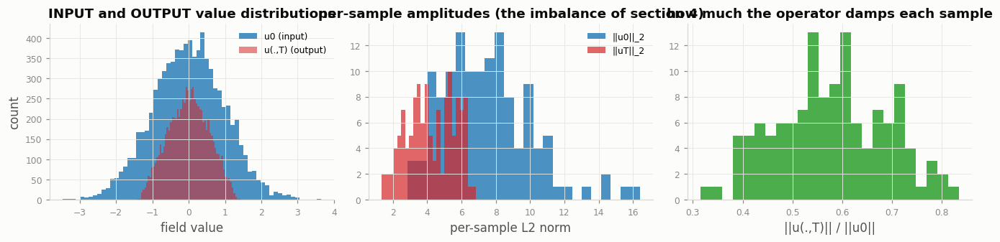 | 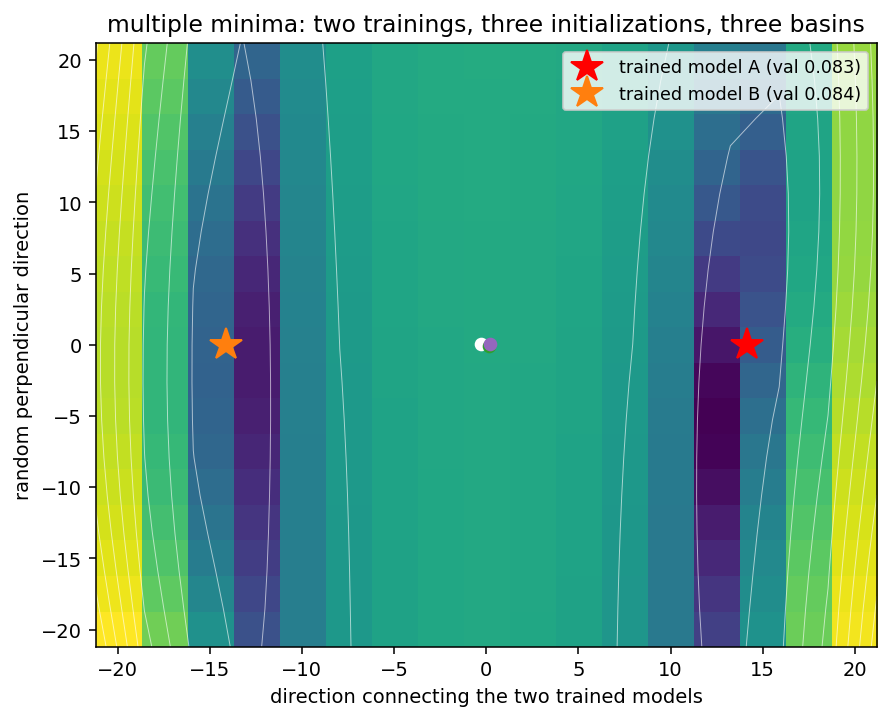 |

The single-minimum view of the same landscape, with four optimizers racing **to the final trained
loss**: Adam arrives in 83 steps, momentum in 463, plain fixed-step SGD never leaves the plateau.
A hyperparameter **corner plot** (modes, width, depth, projection width) and a **3-D view**
complete the section. The payoff of Fourier layers: parameters live on **modes, not grid
points**, so the model trained at $N=64$ evaluates zero-shot at $N=256$ with the same error.

| | |
|---|---|
| 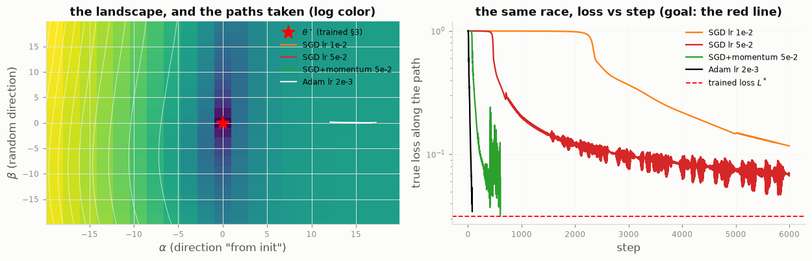 | 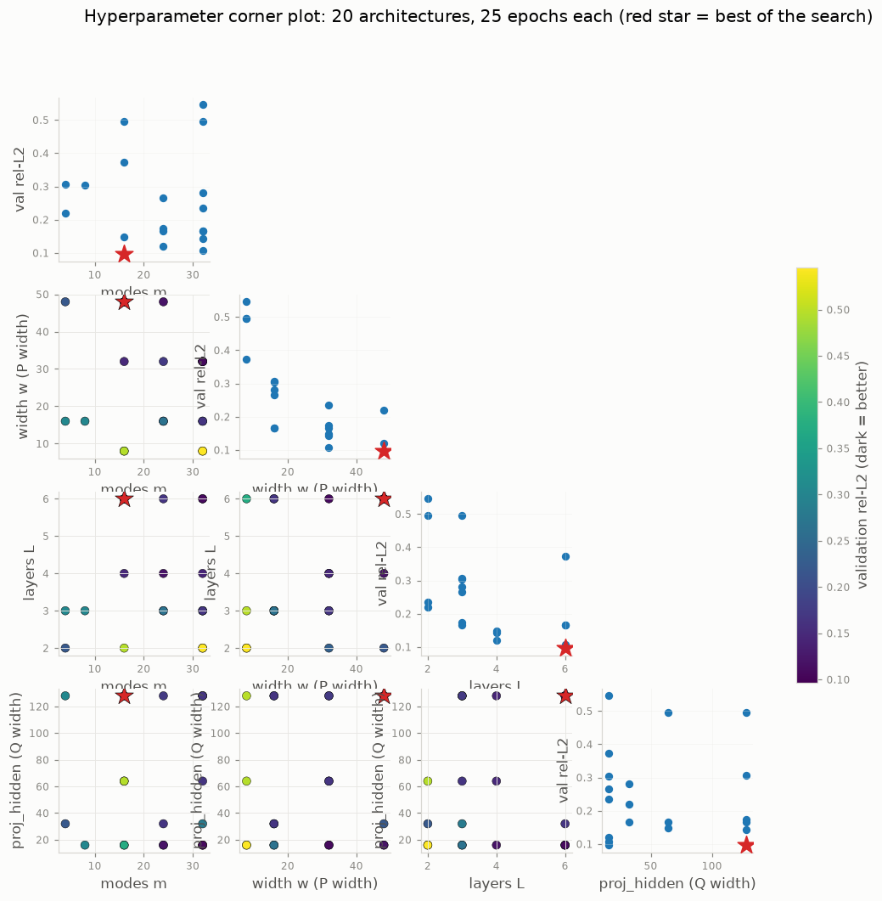 |

**Lab 2 — one operator, profile in → waveforms out, from three complementary viewpoints.**
Top: the input profile (vertical: altitude on $y$, celerity on $x$) and the ray fan it produces.
Bottom: the **hodograph** (each recorded trace at its own absolute arrival times, with the
ray-predicted arrivals) and the value distributions of inputs and outputs.

| | |
|---|---|
| 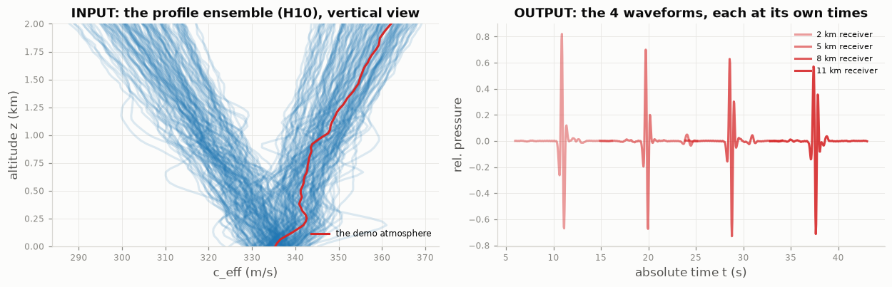 | 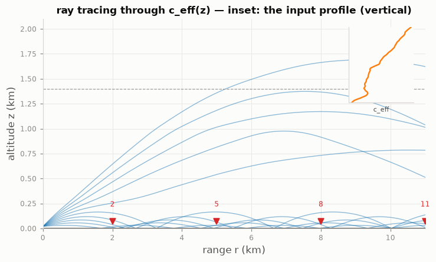 |
| 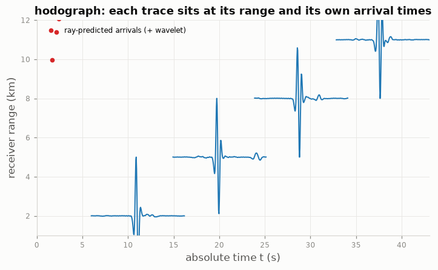 | 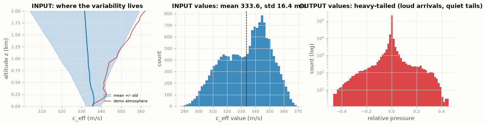 |

The FFNO predicts **all four ground receivers jointly, in one evaluation** — the spectrum of a
recorded trace (Exercise F2) confirms the band the operator must reproduce, and every held-out
prediction comes with its input profile.

| | |
|---|---|
| 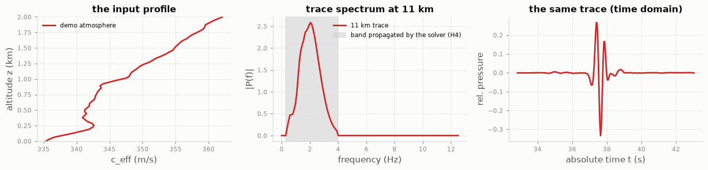 | 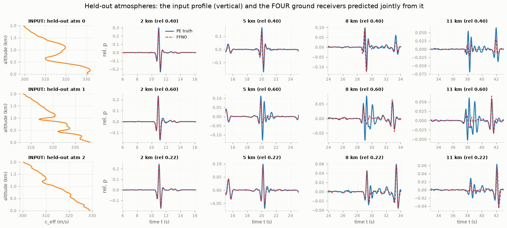 |

**Lab 3 — a graph built by k-NN, and its specific failure mode, quantified.**
Left: the input distributions (per-event station counts change the graph size every event — H3).
Right: oversmoothing made quantitative — node colours homogenize *while the Dirichlet energy
collapses*, with the energy curve animating alongside the map.

| | |
|---|---|
| 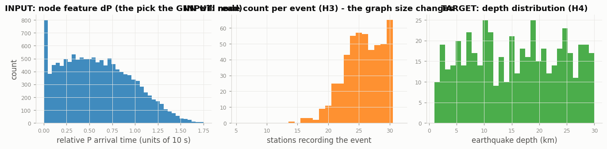 | 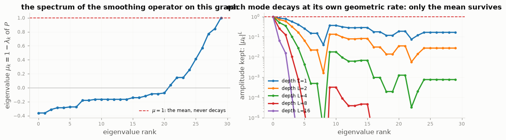 |

The notebook itself animates, step by step, **how k-nearest-neighbours constructs the graph node
by node** (candidates in grey, the 6 selected edges in red, committed edges in blue).

**Extension — a small factorized network, trained long, on a big database.** The FFNO2d of
Lab 2 — deliberately **small** (width 20, modes 14², 5 blocks, 123k parameters, ×6 fewer
spectral parameters per layer than a full 2-D FNO) — trained for **200 epochs** on **2304
pre-generated 96×96 Darcy pairs** (finite-volume ground truth, shipped as a half-precision
85 MB file): the long-schedule regime. Input/output distributions, the spectral check (H5), a
prediction-improving animation, the **learned Fourier weights dissected layer by layer**
(the x/y responses match at ratio 1.03, exactly as the isotropy of the law predicts), and a
worst-case gallery. The executed solution trained the full budget **in 3 minutes on an H100
(~10 minutes on the school's MIG 1g.20gb slice)** and reaches test rel-$L^2$ **0.0083** —
*better* than the ~0.01 the operator-learning literature reports for this benchmark, from a
model smaller than the Burgers lab network. On a laptop CPU set `DARCY_EPOCHS=10`–`20`, or read
the executed solution.

| | | |
|---|---|---|
| 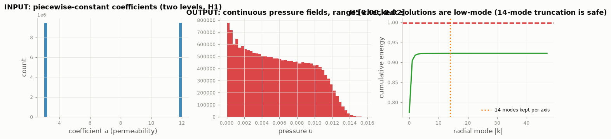 | 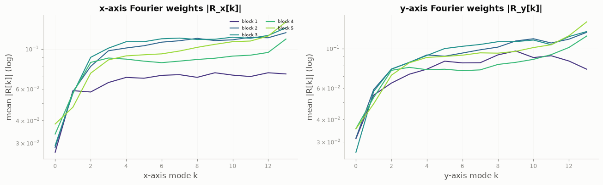 | 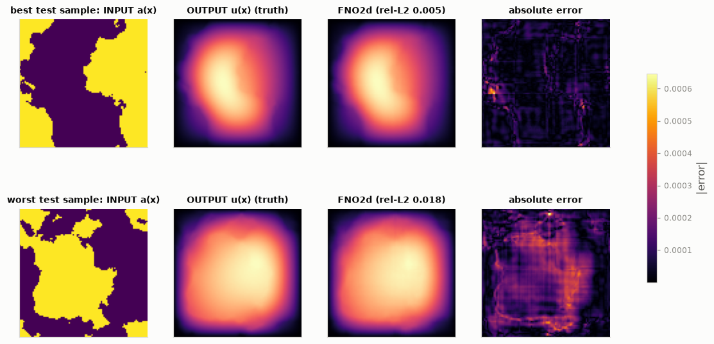 |

More animations (message passing hop by hop, training converging epoch by epoch, code-space
interpolation) live **inside the executed solution notebooks**; a few legacy GIFs are in
[`docs/images/animations/`](docs/images/animations).

---

## Pedagogical design (why a mixed audience can follow all of it)

- **Plain-language main line / optional mathematical notes.** The main line defines every ML
  term before it is used; the mathematical notes state each assumption as a numbered hypothesis —
  the Burgers GRF law (H1), the
  paraxial solver's approximations (H1–H8), the GNN velocity model and pick noise (H1–H7), the
  encoder's information bottleneck (H14), the Darcy data law (H1–H5)… Nothing is used before it
  is defined, and every hypothesis that can be checked on data *is* checked (spectral decay,
  band content, ray vs PE arrivals).
- **Exercises that cannot block anyone:**
  an automatic checker compares against a reference, and on failure the reference takes over.
- **Optional deep dives** (3-D landscapes, corner plots, the overfitting demo under 8 samples)
  are executed in the solutions and skippable live.
- **Honesty as a teaching tool.** Every number the labs report is one the notebooks actually
  produced; the notebooks say which conclusions are robust and which are visualization-level.

---

## Quick start

```bash
git clone <this-repo>
cd letma2026-ml-labs
python -m venv .venv && source .venv/bin/activate
pip install -r requirements.txt          # CPU is enough; GPU optional
jupyter lab                               # or: jupyter notebook
```

Open `notebooks/labs/lab_fno_student.ipynb` and run top to bottom. The three labs generate all
their data on the fly (Burgers pseudo-spectral solver, infrasound parabolic-equation marcher,
synthetic seismic picks) — no downloads. The Darcy scale-up loads its 2304-pair 96×96 database from the shipped
`data/darcy96_big.pt` (half precision, 85 MB; regenerating it requires `scipy` and ~2 minutes).
The two JAX extensions read `data/burgers_jax.npz` (153 kB: Lab 1's Burgers samples, same seeds,
at N=64 and N=256) and `data/seismic_jax.npz` (0.4 MB: Lab 3's seismic events as padded arrays) —
so they need **neither torch nor PyG**, only JAX (regenerate the files with
`python scripts/make_burgers_npz.py` and `python scripts/make_seismic_npz.py` in the PyTorch
environment).

## On the Hedy cluster (school sessions)

The labs are pre-staged in the account's shared folder. One hop, X11 forwarding on:

```bash
ssh -Y hedy                     # the single hop (-Y: X11 forwarding for live plots)

# interactive GPU session on a MIG slice — Slurm drops you ON the node, no second ssh:
srun --pty --account=m26266 --partition=gpu --reservation=test_mig_letma \
     --nodelist=m-gpu[07-08] --gres=gpu:nvidia_h100_80gb_hbm3_1g.20gb:1 \
     --nodes=1 --ntasks=1 --cpus-per-task=8 --time=01:00:00 bash

# then, on the GPU node: first CHECK YOUR SLICE — you should see one MIG device
# with ~20 GB of memory:
nvidia-smi
#   MIG devices:
#   GPU  GI  CI  MIG |              Shared Memory-Usage
#     0   3   0   0  |               9MiB / 20096MiB     <- your 1g.20gb slice
# (if the MIG section is absent or shows another size, exit and resubmit the srun)

source /home/projects/m26266/letma2026-ml-labs/env/fno-gnn/bin/activate   # or your own venv
rsync -a --exclude env /home/projects/m26266/letma2026-ml-labs/ ~/letma2026-ml-labs/  # once
cd ~/letma2026-ml-labs/notebooks/labs
jupyter lab                      # browser interface
# ...or, entirely in the terminal:
euporie-notebook --kernel-name python3 lab_fno_student.ipynb
# optional, with the -Y forwarding: pop-up matplotlib windows instead of inline plots
LAB_PLOT_MODE=tk euporie-notebook --kernel-name python3 lab_fno_student.ipynb
```

**Euporie quick reference** (verified against the installed version — navigate with `↑/↓`
or `j/k`, `Home/End`, `PgUp/PgDn`; `Tab` cycles the focus between notebook, side pane and the
command bar at the bottom):

| action | keys |
|---|---|
| run the selected cell / run and go to next | `Ctrl+Enter` / `Shift+Enter` |
| run and insert a cell below | `Alt+Enter` |
| enter edit mode / leave edit mode | `Enter` / `Esc` |
| insert cell above / below; delete (`d d`); undelete (`z`) | `a` / `b` / `d d` / `z` |
| cut, copy, paste cells | `x` / `c` / `v` |
| cell to markdown / to code | `m` / `y` |
| move cells up / down | `Alt+↑` / `Alt+↓` |
| merge cells / split cell | `M` / `Ctrl+\` |
| expand or collapse output; wrap output; line numbers | `w` / `W` / `l` |
| interrupt kernel / restart kernel | `i i` / `0 0` |
| save / save as / open / new notebook / close tab | `Ctrl+S` / `Alt+S` / `Ctrl+O` / `Ctrl+N` / `Ctrl+W` |
| quit (prompts to save unsaved changes) | `Ctrl+Q` |

Less common actions can be typed in the command bar (Tab to focus it). Figures render inline —
terminal graphics on Kitty/Sixel-capable terminals, character previews elsewhere. The
`python3` kernel is the activated venv's interpreter. The JAX extensions use the sibling venv
`env/jax-hedy` the same way. `slurm/PROCEDURE_TESTS.md` documents the headless re-validation
(`sbatch slurm/test_all_mig.sbatch`).

## Requirements and measured hardware footprint

**Software**: Python ≥ 3.10 (tested on 3.12/3.13); see [`requirements.txt`](requirements.txt).
The three labs need only PyTorch + PyTorch Geometric + NumPy/Matplotlib/Jupyter. Optional:
`scipy` (to regenerate the Darcy database), `jax[cuda12]`/`equinox`/`optax` (the JAX
extensions, separate venv advised).

**Hardware** (measured on the executed solutions):

| Resource | CPU-only (laptop) | GPU (tested on a MIG slice of an H100) |
|---|---|---|
| Processor | any ≥ 2 cores (4+ comfortable) | any CUDA 12 GPU |
| GPU memory | — | **≥ 4 GB** — everything runs on a 19.6 GB `MIG 1g.20gb` instance |
| System RAM | **~1 GB free** (labs), **~3 GB** (scale-up: 1200×2×64² float32) | ~1–3 GB |
| Disk | ~150 MB repo (incl. the 85 MB shipped Darcy database) | same |
| Lab 1 / 2 / 3 runtime | ≈ 8 / 10 / 2 min | **104 s / 159 s / 49 s** |
| Darcy scale-up (200 epochs) | hours — set `DARCY_EPOCHS=10`–`20` or read the solution | **3.0 min** (full H100) / ~10 min (`MIG 1g.20gb`) |
| JAX extensions (full FNO + GNN mirrors) | ≈ 8 / 6 min on CPU | **128 s + 93 s** (solution notebooks; students ≈ same) |

Nothing requires internet access at run time. Results are deterministic (fixed seeds); GPU and
CPU runs agree to ~3 decimals (e.g. Darcy test rel-L2 0.0405 CPU vs 0.0404 GPU).

## Repository layout

```text
letma2026-ml-labs/
├── README.md                     ← this file
├── scripts/
│   ├── setup_participant.sh      ← one-time participant setup (Hedy or laptop)
│   ├── make_burgers_npz.py        ← regenerates data/burgers_jax.npz  (torch env, run once)
│   └── make_seismic_npz.py        ← regenerates data/seismic_jax.npz  (torch env, run once)
├── INSTRUCTOR_GUIDE.md           ← pacing, checkpoints, fallbacks, cluster notes
├── requirements.txt               ← install file (+ optional extras commented)
├── data/
│   ├── darcy96_big.pt            ← pre-generated 96×96 Darcy database (2304 pairs, 85 MB, fp16)
│   ├── burgers_jax.npz           ← Lab 1's Burgers samples as plain arrays (JAX extension, 153 kB)
│   └── seismic_jax.npz           ← Lab 3's seismic events as plain arrays (JAX extension, 0.4 MB)
├── fno_tuto/                      ← Burgers/Darcy data generators, losses, FNO/FFNO models
│   └── infrasound.py              ← parabolic-equation solver + synthetic atmospheres
├── gnn_tuto/                      ← seismic simulator, graph construction, GNN models, checkers
├── hedy_euporie/                  ← tiny optional session-profiler used by the labs
├── notebooks/
│   ├── labs/                      ← the three 30-minute labs (student + executed solution)
│   └── extensions/                ← Darcy scale-up + the two full JAX reimplementations
├── docs/images/                   ← README illustrations (extracted from the executed solutions)
└── slurm/                         ← single-hop validation scripts (see PROCEDURE_TESTS.md)
```

## Reproducibility status

All notebooks were executed end-to-end **without a single error** on a GPU cluster
(MIG 1g.20gb instance of an H100, Slurm reservation). Key reproduced numbers: Burgers test
rel-$L^2$ 0.076 (zero-shot at $N{=}256$: 0.0735); the optimizer race now **reaches the trained
loss** — Adam in 79 steps, SGD+momentum in 604, plain SGD budget-limited; infrasound
(boundary-layer problem, $z\in[0,2]$ km, receivers at 2–11 km): test rel-$L^2$ 0.266, ray
tracing and hodograph on absolute-time axes; GNN epicentral median 4.87 km
vs MLP baseline 6.92 km, smoothing-operator spectrum $\rho=0.844$ predicting the oversmoothing
pace;
Darcy scale-up: a 123k-parameter FFNO2d, 200 epochs on 2304 pairs at 96×96, test rel-$L^2$
0.0083 in 3 GPU minutes on a full H100 (measured; ~10 min on the MIG slice); learned x/y Fourier
responses equal to 3%, as the isotropic law predicts. The two JAX extensions (full mirrors of
Lab 1 and Lab 3 in JAX/Equinox/Optax) reproduce the same physics: FNO val rel-L2 0.0969 / test
0.0867, zero-shot super-resolution 0.0889 at N=256, Adam arrives at the trained loss while SGD
crawls, corner-plot best (modes 16, width 48, layers 6) 0.0896; GNN epicentral median 3.05 km vs
7.04 km for the graph-free MLP baseline — CPU and GPU runs agree to 4 decimals (JAX
determinism), while PyTorch↔JAX differ by seed noise only.

## License

MIT — see [`LICENSE`](LICENSE). If you use these labs for teaching, an acknowledgement of the
LETMA 2026 summer school is appreciated.
